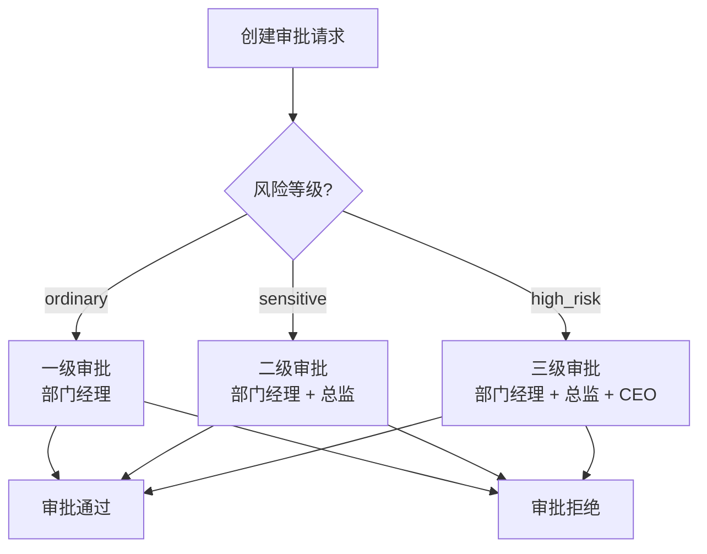

# Agent-Native ERP API 参考文档

> **版本**: 1.0.0
> **最后更新**: 2026-07-30
> **Base URL**: `/api/v1`
> **文档状态**: 正式发布

---

## 目录

1. [API 概述](#1-api-概述)
2. [认证 API](#2-认证-api)
3. [RBAC API](#3-rbac-api)
4. [工作流 API](#4-工作流-api)
5. [知识库 API](#5-知识库-api)
6. [HR API](#6-hr-api)
7. [销售营销 API](#7-销售营销-api)
8. [运营战略 API](#8-运营战略-api)
9. [文档生成 API](#9-文档生成-api)
10. [对话 API](#10-对话-api)
11. [CIO 管理 API](#11-cio-管理-api)
12. [错误码说明](#12-错误码说明)
13. [限流说明](#13-限流说明)

---

## 1. API 概述

### 1.1 基本信息

| 项目 | 说明 |
|---|---|
| Base URL | `/api/v1` |
| 协议 | HTTP/HTTPS |
| 数据格式 | JSON (application/json) |
| 认证方式 | Bearer Token (JWT) |
| 字符编码 | UTF-8 |
| 时区 | Asia/Shanghai (UTC+8) |

### 1.2 认证方式

除公开端点外，所有 API 请求需在 Header 中携带 JWT 访问令牌：

```
Authorization: Bearer <access_token>
```

**公开端点** (无需认证):
- `POST /api/v1/auth/login`
- `POST /api/v1/auth/refresh`
- `GET /health`
- `GET /metrics`
- `GET /docs`
- `GET /openapi.json`
- `GET /api/v1/document/templates`

### 1.3 通用响应格式

**成功响应**:

```json
{
  "message": "操作成功",
  "data": { ... },
  "count": 10
}
```

**错误响应**:

```json
{
  "detail": "错误描述信息"
}
```

**分页响应**:

```json
{
  "total": 100,
  "documents": [ ... ],
  "limit": 50,
  "offset": 0
}
```

### 1.4 HTTP 状态码

| 状态码 | 说明 |
|---|---|
| 200 | 请求成功 |
| 201 | 创建成功 |
| 400 | 请求参数错误 |
| 401 | 未认证 / 令牌无效 |
| 403 | 权限不足 |
| 404 | 资源不存在 |
| 409 | 资源冲突 (如用户名已存在) |
| 429 | 请求过于频繁 (限流) |
| 500 | 服务器内部错误 |
| 503 | 服务不可用 (Agent 未启动) |

---

## 2. 认证 API

### 2.1 用户登录

| 项目 | 说明 |
|---|---|
| 方法 | `POST` |
| 路径 | `/api/v1/auth/login` |
| 认证 | 无需认证 |
| 限流 | 每 IP 每分钟 10 次 |

**请求参数**:

```json
{
  "username": "admin",
  "password": "admin123"
}
```

| 字段 | 类型 | 必填 | 说明 |
|---|---|---|---|
| username | string | 是 | 用户名 (1-64 字符) |
| password | string | 是 | 密码 (1-128 字符) |

**响应示例**:

```json
{
  "access_token": "eyJhbGciOiJIUzI1NiJ9...",
  "refresh_token": "eyJhbGciOiJIUzI1NiJ9...",
  "token_type": "Bearer",
  "expires_in": 1800,
  "user": {
    "user_id": "user_admin001",
    "username": "admin",
    "full_name": "系统管理员",
    "department": "管理层",
    "email": "admin@erp.com",
    "role_codes": ["chairman"],
    "permissions": ["accounting:read", "accounting:create", ...]
  }
}
```

### 2.2 用户登出

| 项目 | 说明 |
|---|---|
| 方法 | `POST` |
| 路径 | `/api/v1/auth/logout` |
| 认证 | 可选 (从 Header 提取令牌) |

**请求参数** (可选 body):

```json
{
  "token": "eyJhbGciOiJIUzI1NiJ9..."
}
```

**响应示例**:

```json
{
  "message": "已登出",
  "success": true
}
```

### 2.3 刷新访问令牌

| 项目 | 说明 |
|---|---|
| 方法 | `POST` |
| 路径 | `/api/v1/auth/refresh` |
| 认证 | 无需认证 (需提供 refresh_token) |

**请求参数**:

```json
{
  "refresh_token": "eyJhbGciOiJIUzI1NiJ9..."
}
```

**响应示例**:

```json
{
  "access_token": "eyJhbGciOiJIUzI1NiJ9...",
  "token_type": "Bearer",
  "expires_in": 1800
}
```

### 2.4 获取当前用户信息

| 项目 | 说明 |
|---|---|
| 方法 | `GET` |
| 路径 | `/api/v1/auth/me` |
| 认证 | 需要认证 |

**响应示例**:

```json
{
  "user_id": "user_admin001",
  "username": "admin",
  "full_name": "系统管理员",
  "department": "管理层",
  "email": "admin@erp.com",
  "role_codes": ["chairman"],
  "roles": [
    {
      "role_code": "chairman",
      "role_name": "董事长",
      "level": 1
    }
  ],
  "permissions": ["accounting:read", "accounting:create", ...]
}
```

### 2.5 获取活跃会话列表

| 项目 | 说明 |
|---|---|
| 方法 | `GET` |
| 路径 | `/api/v1/auth/sessions` |
| 认证 | 需要认证 |

**响应示例**:

```json
{
  "sessions": [
    {
      "created_at": "2026-07-30T10:00:00Z",
      "expires_at": "2026-07-30T10:30:00Z",
      "active": true,
      "token_preview": "eyJhbGciOiJIUz..."
    }
  ],
  "count": 1
}
```

### 2.6 全端登出

| 项目 | 说明 |
|---|---|
| 方法 | `POST` |
| 路径 | `/api/v1/auth/logout-all` |
| 认证 | 需要认证 |

**响应示例**:

```json
{
  "message": "已注销 3 个会话",
  "sessions_invalidated": 3
}
```

---

## 3. RBAC API

### 3.1 用户管理

| 方法 | 路径 | 描述 | 权限要求 |
|---|---|---|---|
| GET | `/api/v1/rbac/users` | 列出所有用户 | 需认证 |
| POST | `/api/v1/rbac/users` | 创建用户 | `user:manage` |
| GET | `/api/v1/rbac/users/{user_id}` | 获取用户详情 | 需认证 |
| PUT | `/api/v1/rbac/users/{user_id}` | 更新用户 | `user:manage` |
| DELETE | `/api/v1/rbac/users/{user_id}` | 删除用户 | `user:manage` |
| GET | `/api/v1/rbac/users/{user_id}/roles` | 获取用户角色 | 需认证 |
| POST | `/api/v1/rbac/users/{user_id}/roles` | 分配角色 | `role:manage` |
| DELETE | `/api/v1/rbac/users/{user_id}/roles` | 收回角色 | `role:manage` |
| GET | `/api/v1/rbac/users/{user_id}/permissions` | 获取用户权限 | 需认证 |

**创建用户请求**:

```json
{
  "username": "zhangsan",
  "password": "password123",
  "full_name": "张三",
  "department": "财务部",
  "email": "zhangsan@erp.com",
  "phone": "13800138000",
  "position": "会计专员"
}
```

**查询参数 (列出用户)**:

| 参数 | 类型 | 说明 |
|---|---|---|
| department | string | 按部门过滤 |
| status | string | 按状态过滤 (active/disabled) |

### 3.2 角色管理

| 方法 | 路径 | 描述 | 权限要求 |
|---|---|---|---|
| GET | `/api/v1/rbac/roles` | 列出所有角色 | 需认证 |
| GET | `/api/v1/rbac/roles/{role_code}` | 获取角色详情 | 需认证 |
| GET | `/api/v1/rbac/roles/{role_code}/permissions` | 获取角色权限 | 需认证 |

**角色列表示例**:

```json
{
  "roles": [
    {
      "role_code": "chairman",
      "role_name": "董事长",
      "level": 1,
      "description": "全系统最高权限"
    },
    {
      "role_code": "ceo",
      "role_name": "CEO",
      "level": 2,
      "description": "全业务域管理权限"
    }
  ],
  "count": 23
}
```

### 3.3 权限管理

| 方法 | 路径 | 描述 | 权限要求 |
|---|---|---|---|
| GET | `/api/v1/rbac/permissions` | 列出所有权限定义 | 需认证 |

**权限列表示例**:

```json
{
  "permissions": [
    {
      "permission_id": "accounting:read",
      "resource": "accounting",
      "action": "read",
      "description": "会计凭证 - read",
      "sensitivity": "normal"
    },
    {
      "permission_id": "treasury:approve",
      "resource": "treasury",
      "action": "approve",
      "description": "资金管理 - approve",
      "sensitivity": "high_risk"
    }
  ],
  "count": 210
}
```

### 3.4 部门管理

| 方法 | 路径 | 描述 | 权限要求 |
|---|---|---|---|
| GET | `/api/v1/rbac/departments` | 列出所有部门 | 需认证 |

### 3.5 统计信息

| 方法 | 路径 | 描述 | 权限要求 |
|---|---|---|---|
| GET | `/api/v1/rbac/stats` | RBAC 引擎统计 | 需认证 |

**响应示例**:

```json
{
  "users": 15,
  "roles": 23,
  "permissions": 210,
  "initialized": true
}
```

---

## 4. 工作流 API

### 4.1 端点总览

| 方法 | 路径 | 描述 | 权限要求 |
|---|---|---|---|
| POST | `/api/v1/workflow/request` | 创建审批请求 | 需认证 |
| GET | `/api/v1/workflow/requests` | 查询审批请求列表 | 需认证 |
| GET | `/api/v1/workflow/requests/{request_id}` | 获取审批请求详情 | 需认证 |
| POST | `/api/v1/workflow/requests/{request_id}/approve` | 审批通过 | 需认证 |
| POST | `/api/v1/workflow/requests/{request_id}/reject` | 审批拒绝 | 需认证 |
| POST | `/api/v1/workflow/requests/{request_id}/cancel` | 撤回审批请求 | 需认证 |
| GET | `/api/v1/workflow/pending` | 获取待我审批的列表 | 需认证 |
| GET | `/api/v1/workflow/stats` | 工作流统计 | 需认证 |

### 4.2 创建审批请求

**请求参数**:

```json
{
  "request_type": "reimbursement",
  "title": "差旅费报销申请",
  "risk_level": "ordinary",
  "details": {
    "amount": 3500,
    "category": "差旅费",
    "description": "北京出差3天"
  },
  "approver_chain": null,
  "timeout_days": null
}
```

| 字段 | 类型 | 必填 | 说明 |
|---|---|---|---|
| request_type | string | 是 | 请求类型: permission_grant / permission_revoke / reimbursement / procurement / budget / contract / custom |
| title | string | 是 | 申请标题 (1-200 字符) |
| risk_level | string | 否 | 风险等级: ordinary (默认) / sensitive / high_risk |
| details | object | 否 | 申请详情 |
| approver_chain | list[string] | 否 | 审批人 ID 列表 (不指定则自动生成) |
| timeout_days | int | 否 | 超时天数 (不指定则按风险等级默认) |

**响应示例**:

```json
{
  "message": "审批请求已创建",
  "request": {
    "request_id": "wf_abc123",
    "requester_id": "user_admin001",
    "request_type": "reimbursement",
    "title": "差旅费报销申请",
    "risk_level": "ordinary",
    "status": "pending",
    "current_step": 1,
    "approver_chain": ["user_manager001", "user_cfo001"],
    "created_at": "2026-07-30T10:00:00Z"
  }
}
```

### 4.3 三级审批流程



### 4.4 查询参数 (列出请求)

| 参数 | 类型 | 说明 |
|---|---|---|
| status | string | 按状态过滤: pending / in_review / approved / rejected / expired / cancelled |
| request_type | string | 按类型过滤 |
| mine | bool | 只看我发起的请求 (默认 false) |

---

## 5. 知识库 API

### 5.1 端点总览

| 方法 | 路径 | 描述 | 权限要求 |
|---|---|---|---|
| POST | `/api/v1/knowledge/search` | 知识检索 | 需认证 |
| POST | `/api/v1/knowledge/ingest/text` | 摄入纯文本 | `knowledge:create` |
| POST | `/api/v1/knowledge/ingest/file` | 上传文件 | `knowledge:create` |
| GET | `/api/v1/knowledge/documents` | 文档列表 | 需认证 |
| GET | `/api/v1/knowledge/documents/{record_id}` | 文档详情 | 需认证 |
| GET | `/api/v1/knowledge/documents/{record_id}/versions` | 文档版本历史 | 需认证 |
| DELETE | `/api/v1/knowledge/documents/{record_id}` | 删除文档 | `knowledge:delete` |
| POST | `/api/v1/knowledge/review/submit` | 提交审批 | 需认证 |
| GET | `/api/v1/knowledge/review/pending` | 待审批列表 | `knowledge:approve` |
| POST | `/api/v1/knowledge/review/{record_id}/approve` | 审批通过 | `knowledge:approve` |
| POST | `/api/v1/knowledge/review/{record_id}/reject` | 审批拒绝 | `knowledge:approve` |
| GET | `/api/v1/knowledge/categories` | 分类列表 | 需认证 |
| POST | `/api/v1/knowledge/categories` | 创建分类 | `knowledge:manage` |
| DELETE | `/api/v1/knowledge/categories/{name}` | 删除分类 | `knowledge:manage` |
| POST | `/api/v1/knowledge/graph/query` | 知识图谱查询 | 需认证 |
| GET | `/api/v1/knowledge/graph/stats` | 知识图谱统计 | 需认证 |
| GET | `/api/v1/knowledge/graph/neighbors/{node_id}` | 获取节点邻居 | 需认证 |
| POST | `/api/v1/knowledge/rules/evaluate` | 规则评估 | 需认证 |
| POST | `/api/v1/knowledge/rules/execute` | 规则执行 | 需认证 |
| GET | `/api/v1/knowledge/rules` | 规则列表 | 需认证 |
| GET | `/api/v1/knowledge/stats` | 知识库统计 | 需认证 |

### 5.2 知识检索

**请求参数**:

```json
{
  "query": "采购流程审批规则",
  "top_k": 5,
  "category": "procurement",
  "tags": ["审批", "采购"]
}
```

| 字段 | 类型 | 必填 | 说明 |
|---|---|---|---|
| query | string | 是 | 查询文本 (1-500 字符) |
| top_k | int | 否 | 返回结果数上限 (1-50, 默认 5) |
| category | string | 否 | 分类过滤 |
| tags | list[string] | 否 | 标签过滤 |

**响应示例**:

```json
{
  "query": "采购流程审批规则",
  "total": 3,
  "results": [
    {
      "doc_id": "doc_001",
      "content": "采购审批流程：金额低于5万元由部门经理审批...",
      "score": 0.89,
      "category": "procurement",
      "metadata": {
        "filename": "采购管理制度.pdf",
        "department": "采购部",
        "permission_level": "internal"
      }
    }
  ]
}
```

### 5.3 文档摄入

**摄入纯文本请求**:

```json
{
  "text": "采购管理制度全文内容...",
  "filename": "采购管理制度.txt",
  "category": "procurement",
  "department": "采购部",
  "permission_level": "internal",
  "tags": ["制度", "采购"],
  "auto_publish": true
}
```

### 5.4 文档查询参数

| 参数 | 类型 | 说明 |
|---|---|---|
| status | string | 按状态过滤: draft / pending / published / rejected / archived |
| category | string | 按分类过滤 |
| department | string | 按部门过滤 |
| limit | int | 返回数量上限 (1-200, 默认 50) |
| offset | int | 偏移量 (默认 0) |

---

## 6. HR API

### 6.1 HR (人力资源) 端点

| 方法 | 路径 | 描述 | 权限要求 |
|---|---|---|---|
| GET | `/api/v1/hr/employees` | 获取员工列表 | 需认证 |
| GET | `/api/v1/hr/employees/{employee_id}` | 获取员工详情 | 需认证 |
| POST | `/api/v1/hr/employees` | 添加员工 | `hr:create` |
| PUT | `/api/v1/hr/employees/{employee_id}` | 更新员工 | `hr:update` |
| POST | `/api/v1/hr/attendance` | 记录考勤 | 需认证 |
| GET | `/api/v1/hr/attendance` | 获取考勤记录 | 需认证 |
| POST | `/api/v1/hr/leave` | 请假申请 | 需认证 |
| GET | `/api/v1/hr/leave` | 获取请假记录 | 需认证 |
| GET | `/api/v1/hr/org-chart` | 获取组织架构 | 需认证 |
| GET | `/api/v1/hr/stats` | HR 统计 | 需认证 |

**添加员工请求**:

```json
{
  "name": "李四",
  "department": "研发部",
  "position": "高级工程师",
  "email": "lisi@erp.com",
  "phone": "13900139000",
  "hire_date": "2026-07-01",
  "base_salary": 25000,
  "allowances": 3000,
  "deductions": 0,
  "manager_id": "emp_001"
}
```

### 6.2 招聘端点

| 方法 | 路径 | 描述 | 权限要求 |
|---|---|---|---|
| GET | `/api/v1/recruitment/positions` | 获取职位列表 | 需认证 |
| POST | `/api/v1/recruitment/positions` | 创建职位 | `recruitment:create` |
| GET | `/api/v1/recruitment/candidates` | 获取候选人列表 | 需认证 |
| POST | `/api/v1/recruitment/candidates` | 添加候选人 | `recruitment:create` |
| PUT | `/api/v1/recruitment/candidates/{candidate_id}/status` | 更新候选人状态 | `recruitment:update` |
| POST | `/api/v1/recruitment/interviews` | 安排面试 | `recruitment:create` |
| GET | `/api/v1/recruitment/interviews` | 获取面试列表 | 需认证 |
| POST | `/api/v1/recruitment/offers` | 发放 Offer | `recruitment:create` |
| GET | `/api/v1/recruitment/offers` | 获取 Offer 列表 | 需认证 |
| GET | `/api/v1/recruitment/stats` | 招聘统计 | 需认证 |

### 6.3 绩效端点

| 方法 | 路径 | 描述 | 权限要求 |
|---|---|---|---|
| GET | `/api/v1/performance/kpi-templates` | 获取 KPI 模板 | 需认证 |
| POST | `/api/v1/performance/kpi-templates` | 创建 KPI 模板 | `performance:create` |
| GET | `/api/v1/performance/cycles` | 获取绩效周期 | 需认证 |
| POST | `/api/v1/performance/cycles` | 创建绩效周期 | `performance:create` |
| POST | `/api/v1/performance/reviews` | 提交绩效评审 | `performance:create` |
| GET | `/api/v1/performance/reviews` | 获取评审记录 | 需认证 |
| POST | `/api/v1/performance/goals` | 设定目标 | `performance:create` |
| GET | `/api/v1/performance/goals` | 获取目标列表 | 需认证 |
| GET | `/api/v1/performance/stats` | 绩效统计 | 需认证 |

### 6.4 薪酬端点

| 方法 | 路径 | 描述 | 权限要求 |
|---|---|---|---|
| GET | `/api/v1/payroll/structure/{employee_id}` | 获取薪资结构 | 需认证 |
| POST | `/api/v1/payroll/structure` | 设置薪资结构 | `payroll:create` |
| POST | `/api/v1/payroll/calculate` | 计算单个员工薪酬 | `payroll:create` |
| POST | `/api/v1/payroll/batch-calculate` | 批量计算薪酬 | `payroll:create` |
| GET | `/api/v1/payroll/records` | 获取薪酬记录 | 需认证 |
| GET | `/api/v1/payroll/social-insurance` | 获取社保配置 | 需认证 |
| PUT | `/api/v1/payroll/social-insurance` | 更新社保配置 | `payroll:update` |
| GET | `/api/v1/payroll/stats` | 薪酬统计 | 需认证 |

---

## 7. 销售营销 API

### 7.1 CRM 端点

| 方法 | 路径 | 描述 | 权限要求 |
|---|---|---|---|
| GET | `/api/v1/crm/customers` | 获取客户列表 | 需认证 |
| POST | `/api/v1/crm/customers` | 创建客户 | `crm:create` |
| PUT | `/api/v1/crm/customers/{customer_id}` | 更新客户 | `crm:update` |
| GET | `/api/v1/crm/opportunities` | 获取商机列表 | 需认证 |
| POST | `/api/v1/crm/opportunities` | 创建商机 | `crm:create` |
| PUT | `/api/v1/crm/opportunities/{opp_id}/stage` | 更新商机阶段 | `crm:update` |
| POST | `/api/v1/crm/contacts` | 添加联系人 | `crm:create` |
| GET | `/api/v1/crm/stats` | CRM 统计 | 需认证 |

### 7.2 销售端点

| 方法 | 路径 | 描述 | 权限要求 |
|---|---|---|---|
| GET | `/api/v1/sales/orders` | 获取销售订单 | 需认证 |
| POST | `/api/v1/sales/orders` | 创建销售订单 | `sales:create` |
| PUT | `/api/v1/sales/orders/{order_id}/status` | 更新订单状态 | `sales:update` |
| GET | `/api/v1/sales/targets` | 获取销售目标 | 需认证 |
| POST | `/api/v1/sales/targets` | 设置销售目标 | `sales:create` |
| GET | `/api/v1/sales/forecast` | 获取销售预测 | 需认证 |
| GET | `/api/v1/sales/stats` | 销售统计 | 需认证 |

### 7.3 营销端点

| 方法 | 路径 | 描述 | 权限要求 |
|---|---|---|---|
| GET | `/api/v1/marketing/campaigns` | 获取营销活动 | 需认证 |
| POST | `/api/v1/marketing/campaigns` | 创建营销活动 | `marketing:create` |
| PUT | `/api/v1/marketing/campaigns/{campaign_id}/status` | 更新活动状态 | `marketing:update` |
| GET | `/api/v1/marketing/leads` | 获取线索列表 | 需认证 |
| POST | `/api/v1/marketing/leads` | 添加线索 | `marketing:create` |
| GET | `/api/v1/marketing/stats` | 营销统计 | 需认证 |

### 7.4 客服端点

| 方法 | 路径 | 描述 | 权限要求 |
|---|---|---|---|
| GET | `/api/v1/cs/tickets` | 获取工单列表 | 需认证 |
| POST | `/api/v1/cs/tickets` | 创建工单 | `customer_service:create` |
| PUT | `/api/v1/cs/tickets/{ticket_id}/status` | 更新工单状态 | `customer_service:update` |
| GET | `/api/v1/cs/complaints` | 获取投诉列表 | 需认证 |
| GET | `/api/v1/cs/satisfaction` | 获取满意度数据 | 需认证 |
| GET | `/api/v1/cs/stats` | 客服统计 | 需认证 |

---

## 8. 运营战略 API

### 8.1 法务端点

| 方法 | 路径 | 描述 | 权限要求 |
|---|---|---|---|
| GET | `/api/v1/legal/consultations` | 获取法律咨询列表 | 需认证 |
| POST | `/api/v1/legal/consultations` | 创建法律咨询 | `legal:create` |
| PUT | `/api/v1/legal/consultations/{id}/answer` | 答复法律咨询 | `legal:update` |
| GET | `/api/v1/legal/lawsuits` | 获取诉讼列表 | 需认证 |
| POST | `/api/v1/legal/lawsuits` | 创建诉讼 | `legal:create` |
| PUT | `/api/v1/legal/lawsuits/{id}/status` | 更新诉讼状态 | `legal:update` |
| GET | `/api/v1/legal/regulations` | 获取法规列表 | 需认证 |
| GET | `/api/v1/legal/stats` | 法务统计 | 需认证 |

### 8.2 风险端点

| 方法 | 路径 | 描述 | 权限要求 |
|---|---|---|---|
| GET | `/api/v1/risk/risks` | 获取风险列表 | 需认证 |
| POST | `/api/v1/risk/risks` | 创建风险 | `risk:create` |
| PUT | `/api/v1/risk/risks/{id}/assess` | 风险评估 | `risk:update` |
| POST | `/api/v1/risk/risks/{id}/mitigate` | 风险缓解 | `risk:update` |
| GET | `/api/v1/risk/matrix` | 风险矩阵 | 需认证 |
| GET | `/api/v1/risk/stats` | 风险统计 | 需认证 |

### 8.3 合同端点

| 方法 | 路径 | 描述 | 权限要求 |
|---|---|---|---|
| GET | `/api/v1/contracts` | 获取合同列表 | 需认证 |
| POST | `/api/v1/contracts` | 创建合同 | `contract:create` |
| GET | `/api/v1/contracts/{id}` | 获取合同详情 | 需认证 |
| PUT | `/api/v1/contracts/{id}/status` | 更新合同状态 | `contract:update` |
| GET | `/api/v1/contracts/templates` | 获取合同模板 | 需认证 |
| GET | `/api/v1/contracts/expiring` | 获取到期合同 | 需认证 |
| GET | `/api/v1/contracts/stats` | 合同统计 | 需认证 |

### 8.4 其他运营战略端点

| 子域 | Base Path | 说明 |
|---|---|---|
| 质量管理 | `/api/v1/quality/*` | 质量检验、标准管理、改进跟踪 |
| 资产管理 | `/api/v1/assets/*` | 资产登记、折旧计算、盘点管理 |
| 项目管理 | `/api/v1/projects/*` | 项目管理、里程碑、成本控制 |
| 预算管理 | `/api/v1/budget/*` | 预算编制、审批、执行监控 |
| 商业智能 | `/api/v1/bi/*` | 经营分析、KPI 仪表盘、趋势分析 |
| ESG 管理 | `/api/v1/esg/*` | ESG 指标、碳排放、社会责任 |

每个子域均提供标准的 CRUD 端点和 `/stats` 统计端点。

---

## 9. 文档生成 API

### 9.1 端点总览

| 方法 | 路径 | 描述 | 权限要求 |
|---|---|---|---|
| POST | `/api/v1/document/generate` | 生成文档 | 需认证 |
| GET | `/api/v1/document/download/{filename}` | 下载文档 | 需认证 |
| GET | `/api/v1/document/templates` | 获取模板列表 | 无需认证 |
| GET | `/api/v1/document/agents/{agent_id}/templates` | 获取 Agent 模板 | 需认证 |

### 9.2 生成文档

**请求参数**:

```json
{
  "agent_id": "accounting",
  "format": "xlsx",
  "template_type": "voucher",
  "filename": "2026年7月会计凭证表",
  "data": {
    "title": "2026年7月会计凭证表",
    "vouchers": [
      {
        "voucher_no": "记-20260701-001",
        "date": "2026-07-01",
        "summary": "销售产品收入",
        "debit": 856000,
        "credit": 856000
      }
    ]
  },
  "title": "2026年7月会计凭证表"
}
```

| 字段 | 类型 | 必填 | 说明 |
|---|---|---|---|
| agent_id | string | 是 | 调用 Agent 的 ID |
| format | string | 是 | 输出格式: docx / xlsx / pptx / pdf |
| template_type | string | 是 | 模板类型: contract / invoice / report / voucher 等 |
| filename | string | 是 | 输出文件名 (不含扩展名) |
| data | object | 是 | 文档数据 (结构化数据，传给生成器) |
| title | string | 否 | 文档标题 |

**响应示例**:

```json
{
  "success": true,
  "file_path": "/tmp/2026年7月会计凭证表.xlsx",
  "filename": "2026年7月会计凭证表.xlsx",
  "format": "xlsx",
  "file_size": 24576,
  "generated_at": "2026-07-30T10:00:00.000Z"
}
```

### 9.3 下载文档

通过文件名下载已生成的文档，返回文件流 (`FileResponse`)。根据文件扩展名自动设置 MIME 类型。

### 9.4 模板列表

**响应示例**:

```json
{
  "total": 22,
  "agents": ["accounting", "tax", "inventory", "procurement", "bi", "hr", "payroll", "invoice", "reimbursement", "audit", "risk"],
  "supported_formats": ["docx", "pdf", "pptx", "xlsx"],
  "generator_templates": { ... },
  "templates": [
    {
      "agent_id": "accounting",
      "template": "voucher",
      "format": "xlsx",
      "name": "会计凭证表"
    }
  ]
}
```

---

## 10. 对话 API

### 10.1 端点总览

| 方法 | 路径 | 描述 | 权限要求 | 限流 |
|---|---|---|---|---|
| GET | `/api/v1/conversation/agents` | 获取可对话的 Agent 列表 | 无需认证 | - |
| POST | `/api/v1/conversation/chat` | 发送消息并获取 Agent 回复 | 无需认证 | 每用户每分钟 10 次 |

### 10.2 对话交互

**请求参数**:

```json
{
  "agent_id": "inventory-agent",
  "message": "查询当前库存状态"
}
```

**响应示例**:

```json
{
  "content": "已为您查询当前库存状态。系统共监控12个品类，其中4项低于安全库存，1项已缺货。库存总价值1,892,450.50元。",
  "thinkingProcess": [
    "解析用户意图：查询库存状态",
    "调用inventory.list()获取全部SKU",
    "按状态分类统计并汇总",
    "生成库存总览数据卡片"
  ],
  "dataCard": {
    "type": "stats",
    "title": "库存状态总览",
    "stats": [
      {"label": "库存品类", "value": "12", "tone": "primary"},
      {"label": "库存总价值", "value": "1,892,450", "tone": "accent"},
      {"label": "预警品类", "value": "5", "tone": "paused"},
      {"label": "缺货品类", "value": "1", "tone": "circuit"}
    ]
  }
}
```

### 10.3 可对话 Agent 列表

| Agent ID | 名称 | 状态 | 能力域 |
|---|---|---|---|
| inventory-agent | 库存管家 | online | 库存查询、补货建议、盘点核对、预警通知 |
| accounting-agent | 会计专员 | online | 凭证生成、凭证审批、科目核对、日清日结 |
| procurement-agent | 采购助手 | online | 供应商比价、采购下单、到货跟踪、合同审核 |
| risk-agent | 风控哨兵 | busy | 实时风控、异常识别、熔断决策、合规检查 |
| settlement-agent | 结算管家 | offline | 日清日结、对账核销、资金调度、流水核对 |

### 10.4 降级机制

当 LLM 不可用时，对话 API 自动降级到**规则匹配模式**：基于关键词匹配返回预设回复，确保服务可用性。

---

## 11. CIO 管理 API

### 11.1 端点总览

所有 CIO 管理端点均在 `/api/v1/admin/` 下，需 `admin:read` 或 `admin:manage` 权限。

| 子模块 | Base Path | 说明 |
|---|---|---|
| 系统监控 | `/api/v1/admin/monitor/*` | 实时指标、历史指标、告警、服务状态 |
| Agent 生命周期 | `/api/v1/admin/lifecycle/*` | Agent 注册、启停、回滚、健康检查 |
| 配置管理 | `/api/v1/admin/config/*` | 配置 CRUD、版本管理、导入导出、热更新 |
| 安全控制 | `/api/v1/admin/security/*` | 安全策略、审计日志、IP/API 密钥管理、安全评分 |
| 数据治理 | `/api/v1/admin/governance/*` | 数据分类、血缘、质量、保留策略、脱敏、合规 |
| 集成平台 | `/api/v1/admin/integration/*` | 连接管理、Webhook、同步任务、健康度 |
| 备份恢复 | `/api/v1/admin/backup/*` | 全量备份、增量备份、调度、恢复、DR 计划 |

### 11.2 系统监控端点

| 方法 | 路径 | 描述 |
|---|---|---|
| GET | `/api/v1/admin/monitor/metrics` | 获取实时系统监控指标 |
| GET | `/api/v1/admin/monitor/metrics/history` | 查询历史监控指标 |
| GET | `/api/v1/admin/monitor/alerts` | 获取监控告警列表 |
| GET | `/api/v1/admin/monitor/services` | 获取各服务组件状态 |
| POST | `/api/v1/admin/monitor/alerts/{alert_id}/acknowledge` | 确认告警 |

### 11.3 Agent 生命周期端点

| 方法 | 路径 | 描述 |
|---|---|---|
| GET | `/api/v1/admin/lifecycle/agents` | 获取所有 Agent 状态 |
| POST | `/api/v1/admin/lifecycle/agents/{agent_id}/pause` | 暂停 Agent |
| POST | `/api/v1/admin/lifecycle/agents/{agent_id}/resume` | 恢复 Agent |
| POST | `/api/v1/admin/lifecycle/agents/{agent_id}/takeover` | 人类接管 |
| POST | `/api/v1/admin/lifecycle/agents/{agent_id}/release` | 释放接管 |
| GET | `/api/v1/admin/lifecycle/agents/{agent_id}/health` | Agent 健康检查 |

---

## 12. 错误码说明

### 12.1 标准 HTTP 错误码

| 状态码 | 错误类型 | 说明 | 处理建议 |
|---|---|---|---|
| 400 | Bad Request | 请求参数错误 | 检查请求参数格式和必填项 |
| 401 | Unauthorized | 未认证或令牌过期 | 重新登录或刷新令牌 |
| 403 | Forbidden | 权限不足 | 联系管理员分配权限 |
| 404 | Not Found | 资源不存在 | 检查资源 ID 是否正确 |
| 409 | Conflict | 资源冲突 | 检查唯一性约束 (如用户名) |
| 429 | Too Many Requests | 请求限流 | 等待 Retry-After 秒后重试 |
| 500 | Internal Server Error | 服务器内部错误 | 查看服务器日志排查 |
| 503 | Service Unavailable | 服务不可用 | Agent 未启动或正在初始化 |

### 12.2 业务错误详情

| 场景 | 状态码 | detail 示例 |
|---|---|---|
| 登录失败 | 401 | "用户名或密码错误" |
| 账号禁用 | 403 | "账号已被禁用，请联系管理员" |
| 令牌过期 | 401 | "刷新令牌无效或已过期" |
| 令牌类型错误 | 401 | "令牌类型错误，需要刷新令牌" |
| 用户名已存在 | 409 | "用户名已存在: zhangsan" |
| 不能删除自己 | 400 | "不能删除当前登录用户" |
| Agent 未启动 | 503 | "HR Agent 未启动" |
| 风险等级无效 | 400 | "无效的风险等级: invalid，可选: ordinary, sensitive, high_risk" |
| 限流 | 429 | "请求过于频繁，请 30 秒后重试" |
| 文档格式不支持 | 400 | "不支持的文档格式: csv，支持: docx, pdf, pptx, xlsx" |
| 非法文件名 | 400 | "非法文件名" (目录穿越攻击) |
| 文件不存在 | 404 | "文件不存在: report.xlsx" |

---

## 13. 限流说明

### 13.1 限流规则

| 规则名称 | 路径匹配 | 方法 | 限制 | Key | 说明 |
|---|---|---|---|---|---|
| auth | `/api/v1/auth` | POST | 10 次/分钟 | IP | 防暴力破解 |
| llm_chat | `/api/v1/conversation/chat` | POST | 10 次/分钟 | User | LLM 成本控制 |
| doc_gen | `/api/v1/document/generate` | POST | 10 次/分钟 | User | 文档生成资源控制 |
| write_ops | (所有路径) | POST/PUT/PATCH/DELETE | 60 次/分钟 | IP | 写操作防滥用 |
| global | (所有路径) | (所有方法) | 120 次/分钟 | IP | 全局通用保护 |

### 13.2 豁免路径

以下路径不受限流影响:

- `/health`
- `/metrics`
- `/docs`
- `/openapi.json`
- `/redoc`
- `/` (根端点)

### 13.3 限流响应

当请求被限流时，返回 `429 Too Many Requests`:

```json
{
  "detail": "请求过于频繁，请 30 秒后重试",
  "retry_after": 30
}
```

**响应头**:

| Header | 说明 |
|---|---|
| `Retry-After` | 建议等待秒数 |
| `X-RateLimit-Rule` | 触发的限流规则名称 |

### 13.4 限流算法

采用**滑动窗口算法**: 记录最近 N 秒内的请求时间戳，超出阈值则拒绝。进程内 Dict 存储 (单实例部署)，多实例部署需替换为 Redis 实现。

---

## 附录: 健康检查与指标端点

### 健康检查

```
GET /health
```

```json
{
  "status": "healthy",
  "service": "erp-backend",
  "version": "1.0.0",
  "timestamp": 1785377478.123
}
```

### Prometheus 指标

```
GET /metrics
```

返回 Prometheus 格式的指标数据，包含:
- HTTP 请求计数和延迟
- Agent 状态和健康指标
- LLM 调用统计
- 数据库连接池状态
- Redis 连接状态
