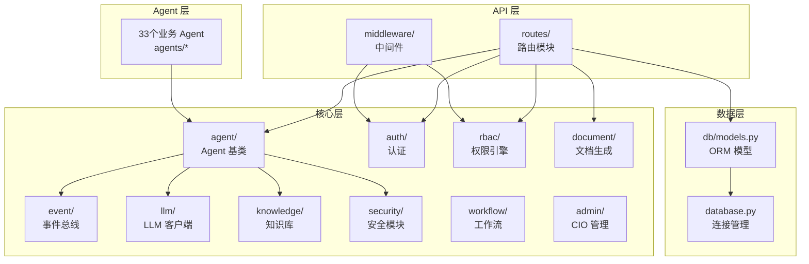
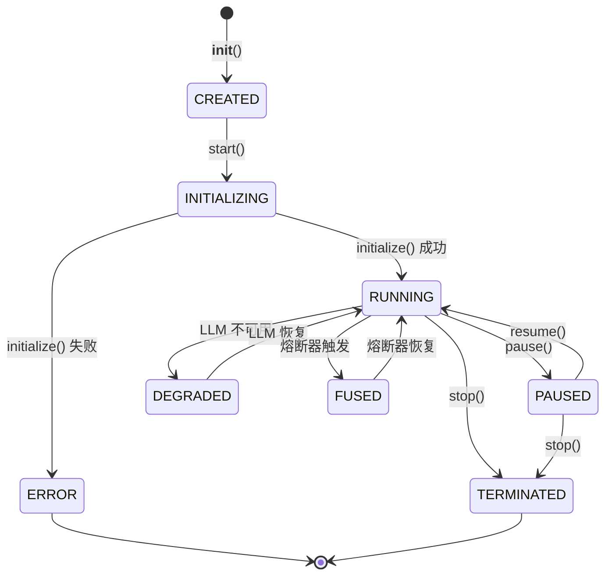
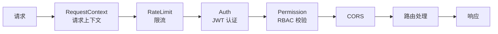
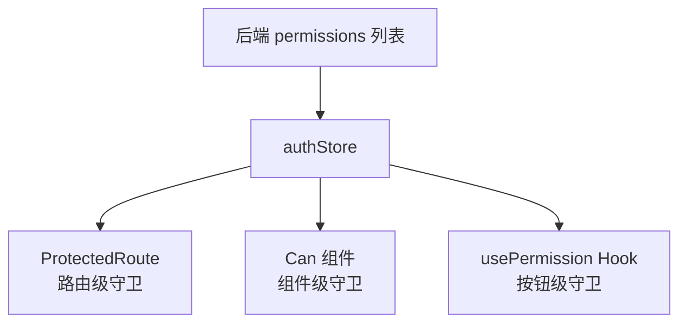
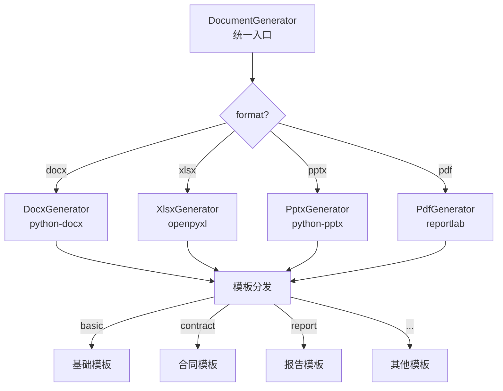
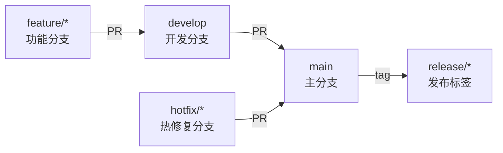

# Agent-Native ERP 开发指南文档

| 属性 | 值 |
|------|------|
| **文档版本** | v1.0.0 |
| **最后更新日期** | 2026-07-30 |
| **文档状态** | 正式发布 |
| **适用版本** | Agent-Native ERP v1.0.0 |

---

## 目录

- [1. 项目目录结构说明](#1-项目目录结构说明)
- [2. 后端开发规范](#2-后端开发规范)
- [3. 前端开发规范](#3-前端开发规范)
- [4. Agent 开发指南](#4-agent-开发指南)
- [5. API 开发指南](#5-api-开发指南)
- [6. 数据库操作指南](#6-数据库操作指南)
- [7. 前端组件开发指南](#7-前端组件开发指南)
- [8. 文档生成开发指南](#8-文档生成开发指南)
- [9. Git 工作流](#9-git-工作流)
- [10. 测试指南](#10-测试指南)

---

## 1. 项目目录结构说明

### 1.1 整体目录结构

```
企业数字化大脑/
├── backend/                    # 后端 FastAPI 服务
│   ├── app/
│   │   ├── main.py             # 应用入口 (FastAPI app, lifespan, 路由注册)
│   │   ├── __init__.py
│   │   ├── agents/             # 33个业务 Agent 实现
│   │   │   ├── inventory/      # Phase 1: 库存守护 Agent
│   │   │   ├── accounting/     # Phase 1: 记账 Agent
│   │   │   ├── procurement/    # Phase 1: 采购 Agent
│   │   │   ├── treasury/       # Phase 1: 资金 Agent
│   │   │   ├── audit/          # Phase 1: 内审 Agent
│   │   │   ├── tax/            # Phase 1: 税务 Agent
│   │   │   ├── compliance/     # Phase 1: 合规 Agent
│   │   │   ├── demand/         # Phase 2: 需求预测 Agent
│   │   │   ├── supply/         # Phase 2: 供应规划 Agent
│   │   │   ├── production/     # Phase 2: 生产 Agent
│   │   │   ├── logistics/      # Phase 2: 物流 Agent
│   │   │   ├── scheduler/      # Phase 2: 动态调度 Agent
│   │   │   ├── invoice/        # Phase 3: 发票 Agent
│   │   │   ├── reimbursement/  # Phase 3: 报销 Agent
│   │   │   ├── knowledge/      # Phase 3: 知识库 Agent
│   │   │   ├── hr/             # Phase 4: 人力资源 Agent
│   │   │   ├── recruitment/    # Phase 4: 招聘 Agent
│   │   │   ├── performance/    # Phase 4: 绩效 Agent
│   │   │   ├── payroll/        # Phase 4: 薪酬 Agent
│   │   │   ├── crm/            # Phase 4: CRM Agent
│   │   │   ├── sales/          # Phase 4: 销售 Agent
│   │   │   ├── marketing/      # Phase 4: 营销 Agent
│   │   │   ├── customer_service/ # Phase 4: 客服 Agent
│   │   │   ├── legal/          # Phase 5: 法务 Agent
│   │   │   ├── risk/           # Phase 5: 风控 Agent
│   │   │   ├── contract/       # Phase 5: 合同 Agent
│   │   │   ├── quality/        # Phase 5: 质量 Agent
│   │   │   ├── asset/          # Phase 5: 资产 Agent
│   │   │   ├── project/        # Phase 5: 项目 Agent
│   │   │   ├── budget/         # Phase 5: 预算 Agent
│   │   │   ├── bi/             # Phase 5: BI Agent
│   │   │   ├── esg/            # Phase 5: ESG Agent
│   │   │   └── admin/          # Phase 5: 管理 Agent
│   │   ├── api/                # API 路由层
│   │   │   ├── routes/         # 路由模块 (auth, rbac, hr, document 等)
│   │   │   └── middleware/     # 中间件 (auth, rate_limit)
│   │   ├── core/               # 核心模块
│   │   │   ├── config.py       # 配置管理 (pydantic-settings)
│   │   │   ├── database.py     # 数据库连接管理
│   │   │   ├── logging_config.py # 结构化日志配置
│   │   │   ├── migrations.py   # 数据库迁移辅助
│   │   │   ├── agent/          # Agent 基类与编排器
│   │   │   │   ├── base.py     # BaseAgent 基类
│   │   │   │   ├── orchestrator.py # Agent 编排器
│   │   │   │   └── tools.py    # 工具注册中心
│   │   │   ├── auth/           # 认证模块 (JWT, password, session)
│   │   │   ├── rbac/           # RBAC 权限引擎
│   │   │   ├── event/          # 事件总线 (内存/Kafka)
│   │   │   ├── llm/            # LLM 客户端 (DeepSeek V4 Pro)
│   │   │   ├── knowledge/      # 知识库 (RAG + TF-IDF + 图谱)
│   │   │   ├── document/       # 文档生成 (docx/xlsx/pptx/pdf)
│   │   │   ├── security/       # 安全模块 (DID, 审计, 护栏)
│   │   │   ├── workflow/       # 工作流引擎
│   │   │   ├── blockchain/     # 区块链审计 (Hyperledger Fabric)
│   │   │   ├── versioning/     # 版本化与灰度发布
│   │   │   └── admin/          # CIO 管理模块 (7个子模块)
│   │   └── db/                 # ORM 模型
│   │       ├── models.py       # SQLAlchemy 模型定义
│   │       └── database.py     # 同步数据库连接 (Alembic 用)
│   ├── alembic/                # Alembic 迁移脚本
│   ├── alembic.ini             # Alembic 配置
│   ├── requirements.txt        # Python 依赖
│   ├── Dockerfile              # 后端 Docker 镜像
│   ├── .env.example            # 环境变量模板
│   └── .env                    # 环境变量 (不提交)
├── frontend/                   # 前端 React 应用
│   ├── src/
│   │   ├── App.tsx             # 应用根组件
│   │   ├── main.tsx            # 应用入口
│   │   ├── components/         # 可复用组件
│   │   │   ├── Can.tsx         # 权限守卫组件
│   │   │   ├── ProtectedRoute.tsx # 路由权限守卫
│   │   │   ├── Layout.tsx      # 布局组件
│   │   │   ├── ExportButton.tsx # 导出按钮组件
│   │   │   └── ui/             # 基础 UI 组件
│   │   ├── hooks/              # 自定义 Hooks
│   │   │   └── usePermission.ts # 权限检查 Hook
│   │   ├── pages/              # 页面组件 (31 个页面)
│   │   ├── services/           # API 服务层
│   │   │   ├── api.ts          # Axios 实例与拦截器
│   │   │   ├── authService.ts  # 认证服务
│   │   │   └── websocket.ts    # WebSocket 服务
│   │   ├── stores/             # Zustand 状态管理
│   │   │   ├── authStore.ts    # 认证状态
│   │   │   └── systemStore.ts  # 系统状态
│   │   ├── lib/                # 工具函数
│   │   └── test/               # 测试配置
│   ├── package.json            # Node.js 依赖
│   ├── Dockerfile              # 前端 Docker 镜像
│   ├── vite.config.ts          # Vite 配置
│   ├── tsconfig.json           # TypeScript 配置
│   └── tailwind.config.js      # Tailwind CSS 配置
├── infra/                      # 基础设施配置
│   ├── k8s/                    # Kubernetes 部署文件
│   ├── istio/                  # Istio 服务网格配置
│   ├── monitoring/             # Prometheus + Grafana 配置
│   ├── prometheus/             # 告警规则
│   └── docker/                 # Docker 初始化脚本
├── .github/workflows/          # GitHub Actions CI/CD
│   ├── ci.yml                  # 持续集成流水线
│   └── deploy.yml              # 持续部署流水线
├── docker-compose.yml          # Docker Compose 编排
└── docs/                       # 项目文档
    ├── architecture.md         # 系统架构文档
    ├── api-reference.md        # API 参考文档
    ├── deployment.md           # 部署运维文档
    └── development.md          # 开发指南文档 (本文档)
```

### 1.2 后端模块分层



---

## 2. 后端开发规范

### 2.1 代码风格

#### ruff 配置

项目使用 `ruff` 进行代码检查, 配置在 `pyproject.toml` 或 `ruff.toml`:

```toml
[tool.ruff]
target-version = "py312"
line-length = 120

[tool.ruff.lint]
select = [
    "E",    # pycodestyle errors
    "W",    # pycodestyle warnings
    "F",    # pyflakes
    "I",    # isort
    "B",    # flake8-bugbear
    "C4",   # flake8-comprehensions
    "UP",   # pyupgrade
]
ignore = ["E501"]  # 行长度由 black 管理

[tool.ruff.lint.isort]
known-first-party = ["app"]
```

#### black 配置

```toml
[tool.black]
line-length = 120
target-version = ["py312"]
```

#### 代码规范要点

```python
# 1. 导入排序: 标准库 → 第三方 → 本项目
import asyncio
from datetime import datetime, timezone
from typing import Optional

import structlog
from fastapi import APIRouter, Depends

from app.core.config import settings

# 2. 类型注解: 所有函数参数和返回值必须有类型注解
async def get_user(user_id: str) -> Optional[dict]:
    """获取用户信息 (docstring 使用三引号).

    Args:
        user_id: 用户 ID.

    Returns:
        用户信息字典, 不存在时返回 None.
    """
    pass

# 3. 异步优先: 所有 I/O 操作使用 async/await
async def fetch_data(url: str) -> dict:
    async with httpx.AsyncClient() as client:
        response = await client.get(url)
        return response.json()

# 4. 结构化日志: 使用 structlog, 不使用 print
logger = structlog.get_logger()
logger.info("user.login", user_id=user_id, ip_address=ip)
```

### 2.2 检查命令

```bash
# ruff 检查
ruff check backend/

# ruff 自动修复
ruff check backend/ --fix

# black 格式化检查
black --check backend/

# black 自动格式化
black backend/

# bandit 安全扫描
bandit -r backend/ -ll
```

### 2.3 配置管理

所有配置通过 `pydantic-settings` 的 `Settings` 类管理, 从环境变量注入:

```python
from app.core.config import settings

# 使用配置
db_url = settings.mysql_url
llm_enabled = settings.llm_enabled
jwt_secret = settings.jwt_secret
```

> 禁止在代码中硬编码配置值, 所有可配置项必须通过 `Settings` 类管理。

---

## 3. 前端开发规范

### 3.1 代码风格

#### ESLint 配置

项目使用 ESLint 进行代码检查, 配置在 `frontend/.eslintrc.cjs`:

```javascript
module.exports = {
  root: true,
  env: { browser: true, es2020: true },
  extends: [
    'eslint:recommended',
    'plugin:@typescript-eslint/recommended',
    'plugin:react-hooks/recommended',
  ],
  parser: '@typescript-eslint/parser',
  plugins: ['react-refresh'],
  rules: {
    'react-refresh/only-export-components': 'warn',
    '@typescript-eslint/no-unused-vars': 'error',
    '@typescript-eslint/no-explicit-any': 'warn',
  },
}
```

#### TypeScript 规范

```typescript
// 1. 始终使用类型注解, 避免 any
interface User {
  id: string
  name: string
  role: string
  permissions: string[]
}

// 2. 函数组件使用函数声明
export default function Dashboard() {
  const { can } = usePermission()
  return <div>{can('dashboard', 'read') && <Content />}</div>
}

// 3. 状态管理使用 Zustand, 不使用 Context + useReducer
// 4. 样式使用 Tailwind CSS, 不使用内联样式对象
// 5. API 调用统一通过 services/ 层
```

### 3.2 检查命令

```bash
cd frontend

# ESLint 检查
npm run lint

# ESLint 自动修复
npm run lint:fix

# TypeScript 类型检查
npm run typecheck

# 构建
npm run build
```

### 3.3 前端目录约定

| 目录 | 用途 | 示例 |
|------|------|------|
| `components/` | 可复用组件 | `Can.tsx`, `Layout.tsx` |
| `pages/` | 页面组件 (一一对应路由) | `Dashboard.tsx`, `Login.tsx` |
| `hooks/` | 自定义 Hooks | `usePermission.ts` |
| `services/` | API 调用封装 | `api.ts`, `authService.ts` |
| `stores/` | Zustand 状态管理 | `authStore.ts` |
| `lib/` | 工具函数 | `utils.ts` |

---

## 4. Agent 开发指南

### 4.1 Agent 基类 (BaseAgent)

所有业务 Agent 继承 `BaseAgent` 抽象基类 (`app/core/agent/base.py`), 该基类提供:

| 特性 | 说明 |
|------|------|
| 完整生命周期状态机 | CREATED -> INITIALIZING -> RUNNING -> (PAUSED/DEGRADED/FUSED) -> TERMINATED |
| 事件驱动感知 | 订阅事件总线, 响应业务变化 |
| 安全治理集成 | DID 身份, 意图授权, 审计记录, 护栏过滤 |
| 健康探针与熔断器 | SLO 监控, 自动降级 |
| 人在回路 | 人类可随时暂停, 接管, 终止 |
| 工具调用沙箱 | 安全执行注册工具 |
| LLM 认知引擎集成 | llm_chat / llm_analyze, 自动降级到规则模式 |

### 4.2 创建新 Agent

#### 步骤 1: 创建 Agent 目录和文件

```
backend/app/agents/<agent_name>/
├── __init__.py    # 导出 Agent 类
└── agent.py       # Agent 实现
```

#### 步骤 2: 实现 Agent 类

```python
"""
<Agent名称> Agent
<Agent职责描述>
"""
from datetime import datetime, timezone
from typing import Optional

from app.core.agent.base import BaseAgent, AgentDecision
from app.core.config import settings
from app.core.event.models import Event, EventType


class MyNewAgent(BaseAgent):
    """新 Agent - <功能描述>"""

    def __init__(self):
        super().__init__(
            name="新Agent",                    # Agent 显示名称
            domain="my_domain",                # 业务域
            capabilities=[                      # 能力声明列表
                "my_capability_1",
                "my_capability_2",
                "general",
            ],
            security_clearance="internal",      # 安全级别: public/internal/confidential/top_secret
        )
        # Agent 内部状态
        self._data: dict = {}

    @property
    def description(self) -> str:
        """Agent 描述 (必须实现)"""
        return "负责 <功能描述>"

    async def initialize(self):
        """初始化 Agent (必须实现)

        在此方法中:
        - 订阅事件
        - 加载配置
        - 初始化内部状态
        """
        # 订阅事件
        self.subscribe_events(
            event_types=[
                EventType.SOME_EVENT,
            ],
            handler=self._handle_event,
        )
        # 加载初始数据
        self._data = {}

    async def process_event(self, event: Event):
        """处理接收到的事件 (必须实现)

        Args:
            event: 事件对象, 包含 event_type, payload, metadata
        """
        if event.event_type == EventType.SOME_EVENT:
            await self._handle_some_event(event.payload)

    async def make_decision(self, context: dict) -> AgentDecision:
        """做出决策 (必须实现)

        Args:
            context: 决策上下文

        Returns:
            AgentDecision 对象
        """
        # 1. 尝试 LLM 决策 (如果启用)
        if settings.llm_enabled:
            try:
                response = await self.llm_analyze(
                    prompt=f"基于以下上下文做出决策: {context}",
                    context=context,
                )
                return AgentDecision(
                    decision_type="llm_analysis",
                    reasoning=response.get("reasoning", ""),
                    action=response.get("action", ""),
                    confidence=response.get("confidence", 0.5),
                    requires_human_approval=response.get("requires_human", False),
                    context=context,
                )
            except Exception:
                # LLM 不可用时降级到规则引擎
                pass

        # 2. 规则引擎决策 (降级策略)
        return self._rule_based_decision(context)

    def _rule_based_decision(self, context: dict) -> AgentDecision:
        """规则引擎决策 (降级策略)"""
        # 实现基于规则的决策逻辑
        return AgentDecision(
            decision_type="rule_based",
            reasoning="基于规则的决策",
            action="default_action",
            confidence=0.7,
            context=context,
        )

    async def _handle_some_event(self, payload: dict):
        """处理特定事件"""
        pass
```

#### 步骤 3: 注册 Agent

在 `app/main.py` 中注册新 Agent:

```python
# 1. 导入
from app.agents.my_new_agent.agent import MyNewAgent

# 2. 全局变量
my_new_agent: MyNewAgent = None

# 3. 在 lifespan 函数中创建并注册
async def lifespan(app: FastAPI):
    global my_new_agent
    # ... 其他 Agent 初始化 ...

    # 创建 Agent
    my_new_agent = MyNewAgent()
    await orchestrator.register_agent(my_new_agent)

    # 启动 Agent
    await my_new_agent.start()

    # ... 其他逻辑 ...
    yield

    # 关闭
    await orchestrator.stop_all()
```

#### 步骤 4: 注入到路由 (如需 API 访问)

在 `app/api/routes/_agent_refs.py` 中添加引用:

```python
# app/api/routes/_agent_refs.py
_my_agent = None

def set_agents(..., my_agent=None):
    global _my_agent
    _my_agent = my_agent

def get_my_agent():
    return _my_agent
```

### 4.3 Agent 能力声明

能力声明 (`capabilities`) 用于:

1. **RBAC 权限控制**: Agent 操作权限映射 (33 Agent x 9 角色类型)
2. **工具调用授权**: Agent 只能调用其能力范围内的工具
3. **事件订阅过滤**: Agent 只接收与其能力相关的事件

```python
capabilities=[
    "invoice_issuance",       # 发票开具
    "invoice_verification",   # 发票验证
    "invoice_management",     # 发票管理
    "invoice_statistics",     # 发票统计
    "tax_rate_matching",      # 税率匹配
    "general",                # 通用能力 (所有 Agent 必须包含)
]
```

### 4.4 降级策略

所有 Agent 必须实现降级策略, 确保 LLM 不可用时系统仍能正常运行:

```python
async def make_decision(self, context: dict) -> AgentDecision:
    # 1. 优先使用 LLM (如果启用)
    if settings.llm_enabled:
        try:
            response = await self.llm_analyze(
                prompt=self._build_prompt(context),
                context=context,
            )
            return AgentDecision(
                decision_type="llm",
                reasoning=response["reasoning"],
                action=response["action"],
                confidence=response["confidence"],
            )
        except Exception as e:
            logger.warning("agent.llm_fallback", agent=self.name, error=str(e))

    # 2. 降级到规则引擎
    return self._rule_based_decision(context)
```

### 4.5 Agent 生命周期



### 4.6 BaseAgent 关键方法

| 方法 | 类型 | 说明 |
|------|------|------|
| `start()` | async | 启动 Agent (注册 DID, 审计, 初始化, 启动主循环) |
| `stop()` | async | 停止 Agent (取消任务, 取消订阅, 吊销身份) |
| `pause(reason)` | async | 暂停 Agent |
| `resume()` | async | 恢复 Agent |
| `initialize()` | abstract | 子类实现: 加载配置, 注册订阅 |
| `process_event(event)` | abstract | 子类实现: 处理事件 |
| `make_decision(context)` | abstract | 子类实现: 做出决策 |
| `subscribe_events(...)` | | 订阅事件总线 |
| `llm_chat(prompt)` | async | 调用 LLM 对话 (自动降级) |
| `llm_analyze(prompt, context)` | async | 调用 LLM 分析 (自动降级) |
| `_publish_event(event_type, payload)` | async | 发布事件到事件总线 |

---

## 5. API 开发指南

### 5.1 路由注册

#### 路由模块结构

每个功能域对应一个路由模块, 位于 `app/api/routes/`:

```python
# app/api/routes/my_module.py
from fastapi import APIRouter, Depends, HTTPException
from app.api.middleware.auth import get_current_user, require_permission

router = APIRouter(prefix="/api/v1/my-module", tags=["我的模块"])

@router.get("/")
@require_permission("my_resource", "read")
async def list_items(current_user: dict = Depends(get_current_user)):
    """获取列表"""
    # 业务逻辑
    return {"items": []}

@router.post("/")
@require_permission("my_resource", "create")
async def create_item(data: dict, current_user: dict = Depends(get_current_user)):
    """创建项目"""
    # 业务逻辑
    return {"id": "new_id", **data}
```

#### 路由注册到应用

在 `app/api/routes/__init__.py` 中注册:

```python
from app.api.routes.my_module import router as my_module_router

api_router.include_router(my_module_router)
```

在 `app/main.py` 中包含路由:

```python
from app.api.routes import my_module_router

app.include_router(my_module_router)
```

### 5.2 中间件

系统使用四个中间件, 按洋葱模型执行:



#### 公开端点白名单

在 `app/api/middleware/auth.py` 中定义:

```python
PUBLIC_PATHS = [
    r"^/api/v1/auth/login$",
    r"^/api/v1/auth/refresh$",
    r"^/health",
    r"^/metrics",
    r"^/docs",
    r"^/openapi\.json",
    r"^/$",
]
```

### 5.3 权限控制

#### 路径 -> 权限映射

在 `app/api/middleware/auth.py` 的 `PERMISSION_RULES` 中配置:

```python
PERMISSION_RULES = [
    # (路径正则, HTTP方法, 资源, 动作)
    (r"^/api/v1/invoice", "GET", "invoice", "read"),
    (r"^/api/v1/invoice/issue", "POST", "invoice", "create"),
    (r"^/api/v1/invoice/.+/(verify|cancel)", "POST", "invoice", "update"),
]
```

#### 路由级权限控制

使用 `require_permission` 装饰器:

```python
from app.api.middleware.auth import require_permission, get_current_user
from fastapi import Depends

@router.post("/issue")
@require_permission("invoice", "create")
async def issue_invoice(data: dict, current_user = Depends(get_current_user)):
    """开具发票 (需要 invoice:create 权限)"""
    pass
```

### 5.4 通用响应格式

```python
# 成功响应
{
    "code": 0,
    "message": "success",
    "data": { ... }
}

# 错误响应
{
    "code": 403,
    "message": "权限不足",
    "detail": "需要 invoice:create 权限"
}
```

---

## 6. 数据库操作指南

### 6.1 SQLAlchemy ORM 模型

模型定义在 `app/db/models.py`:

```python
from sqlalchemy import Column, String, Integer, DateTime, Text, Boolean
from sqlalchemy.orm import DeclarativeBase

class Base(DeclarativeBase):
    pass

class User(Base):
    __tablename__ = "users"

    id = Column(String(36), primary_key=True)
    username = Column(String(100), unique=True, nullable=False)
    email = Column(String(200), unique=True, nullable=False)
    password_hash = Column(String(255), nullable=False)
    role_code = Column(String(50), nullable=False)
    department_id = Column(String(36), nullable=True)
    is_active = Column(Boolean, default=True)
    created_at = Column(DateTime, nullable=False)
    updated_at = Column(DateTime, nullable=False)
```

### 6.2 异步数据库操作

```python
from sqlalchemy import select, update, delete
from sqlalchemy.ext.asyncio import AsyncSession
from app.core.database import get_db_session
from app.db.models import User

# 查询
async def get_user(user_id: str) -> Optional[User]:
    async with get_db_session() as session:
        result = await session.execute(
            select(User).where(User.id == user_id)
        )
        return result.scalar_one_or_none()

# 创建
async def create_user(data: dict) -> User:
    async with get_db_session() as session:
        user = User(**data)
        session.add(user)
        await session.commit()
        await session.refresh(user)
        return user

# 更新
async def update_user(user_id: str, data: dict) -> bool:
    async with get_db_session() as session:
        result = await session.execute(
            update(User)
            .where(User.id == user_id)
            .values(**data)
        )
        await session.commit()
        return result.rowcount > 0

# 删除
async def delete_user(user_id: str) -> bool:
    async with get_db_session() as session:
        result = await session.execute(
            delete(User).where(User.id == user_id)
        )
        await session.commit()
        return result.rowcount > 0
```

### 6.3 连接池配置

```python
# app/core/database.py
from sqlalchemy.ext.asyncio import create_async_engine

engine = create_async_engine(
    settings.mysql_url,
    pool_size=settings.db_pool_size,           # 常驻连接数
    max_overflow=settings.db_max_overflow,     # 溢出上限
    pool_timeout=settings.db_pool_timeout,     # 获取超时
    pool_recycle=settings.db_pool_recycle,     # 回收周期 (1800s)
    echo=settings.db_echo,                     # SQL 日志
)
```

> **重要**: 不要使用 `pool_pre_ping=True`, 它与 aiomysql 的 `ping()` 签名不兼容。使用 `pool_recycle=1800` 替代。

### 6.4 Alembic 迁移

```bash
cd backend

# 1. 修改 ORM 模型 (app/db/models.py)
# 2. 生成迁移脚本
alembic revision --autogenerate -m "add_new_table"

# 3. 检查生成的迁移脚本 (alembic/versions/xxx_add_new_table.py)
# 4. 应用迁移
alembic upgrade head

# 5. 回滚
alembic downgrade -1
```

迁移脚本示例:

```python
# alembic/versions/20260730_1000_abc123_add_new_table.py
from alembic import op
import sqlalchemy as sa

def upgrade():
    op.create_table(
        "new_table",
        sa.Column("id", sa.String(36), primary_key=True),
        sa.Column("name", sa.String(100), nullable=False),
        sa.Column("created_at", sa.DateTime, nullable=False),
    )

def downgrade():
    op.drop_table("new_table")
```

---

## 7. 前端组件开发指南

### 7.1 权限控制体系

前端权限控制使用三层机制:



### 7.2 ProtectedRoute - 路由级权限守卫

`ProtectedRoute` 用于保护页面路由, 未认证跳转登录页, 权限不足显示 403:

```tsx
import ProtectedRoute from './components/ProtectedRoute'

// 在路由配置中使用
<Route
  path="/invoice"
  element={
    <ProtectedRoute resource="invoice" action="read">
      <InvoicePage />
    </ProtectedRoute>
  }
/>

// 需要管理权限的页面
<Route
  path="/admin"
  element={
    <ProtectedRoute resource="admin" action="manage">
      <AdminPage />
    </ProtectedRoute>
  }
/>
```

### 7.3 Can 组件 - 组件级权限守卫

`Can` 组件用于条件渲染, 仅当用户拥有指定权限时才渲染子组件:

```tsx
import Can from './components/Can'

// 单项权限检查
<Can resource="invoice" action="create">
  <Button>开具发票</Button>
</Can>

// 多项权限检查 (全部满足)
<Can permissions={["invoice:read", "invoice:create"]}>
  <Button>开具</Button>
</Can>

// 多项权限检查 (任一满足)
<Can permissions={["invoice:read", "report:read"]} mode="any">
  <Button>查看</Button>
</Can>

// 权限不足时显示替代内容
<Can
  resource="system"
  action="manage"
  fallback={<span className="text-slate-600">-</span>}
>
  <Button>管理</Button>
</Can>
```

### 7.4 usePermission Hook - 按钮级权限检查

```tsx
import { usePermission } from './hooks/usePermission'

function InvoicePage() {
  const { can, canAll, canAny, hasRole } = usePermission()

  return (
    <div>
      {/* 单项权限检查 */}
      {can('invoice', 'create') && (
        <Button color="primary">开具发票</Button>
      )}

      {/* 批量权限检查 (全部满足) */}
      {canAll(['invoice:read', 'invoice:update']) && (
        <Button>编辑发票</Button>
      )}

      {/* 批量权限检查 (任一满足) */}
      {canAny(['invoice:delete', 'admin:manage']) && (
        <Button color="danger">删除发票</Button>
      )}

      {/* 角色检查 */}
      {hasRole('CFO') && (
        <Badge>CFO 视图</Badge>
      )}
    </div>
  )
}
```

### 7.5 权限格式

权限使用 `resource:action` 二维结构:

| 资源 (resource) | 动作 (action) | 说明 |
|-----------------|--------------|------|
| invoice | read / create / update / delete / approve / manage | 发票管理 |
| reimbursement | read / create / update / delete / approve / manage | 报销管理 |
| knowledge | read / create / update / delete / approve / manage | 知识库 |
| hr | read / create / update / delete / approve / manage | 人力资源 |
| agent | read / manage | Agent 管理 |
| system | read / manage | 系统管理 |
| workflow | read / create / update / approve / manage | 工作流 |
| document | read / create / manage | 文档生成 |

共 15 个资源模块 x 6 种动作。

### 7.6 前端菜单动态过滤

前端菜单基于用户权限列表动态过滤:

```tsx
// 菜单项必须包含 permission 元数据
const menuItems = [
  {
    label: '发票管理',
    path: '/invoice',
    icon: <FileText />,
    permission: 'invoice:read',  // 权限元数据
  },
  {
    label: '系统管理',
    path: '/admin',
    icon: <Settings />,
    permission: 'system:manage',
  },
]

// 根据权限过滤菜单
const filteredMenu = menuItems.filter(item => {
  if (!item.permission) return true
  const [resource, action] = item.permission.split(':')
  return can(resource, action)
})
```

> **重要**: 前端权限检查必须使用后端返回的实时 `permissions` 列表, 不使用硬编码的角色-权限映射。

### 7.7 API 服务层

所有 API 调用通过 `services/api.ts` 统一管理:

```typescript
// services/api.ts
import axios from 'axios'

const api = axios.create({
  baseURL: '/api/v1',
  timeout: 30000,
})

// 请求拦截器: 自动注入 JWT
api.interceptors.request.use((config) => {
  const token = localStorage.getItem('token')
  if (token) {
    config.headers.Authorization = `Bearer ${token}`
  }
  return config
})

// 响应拦截器: 统一错误处理
api.interceptors.response.use(
  (response) => response.data,
  (error) => {
    if (error.response?.status === 401) {
      // Token 过期, 跳转登录
      window.location.href = '/login'
    }
    return Promise.reject(error)
  }
)

export default api
```

---

## 8. 文档生成开发指南

### 8.1 文档生成架构



### 8.2 使用文档生成器

```python
from app.core.document import DocumentGenerator

generator = DocumentGenerator()

# 生成 Word 文档
path = generator.generate(
    format="docx",
    template_type="contract",
    data={
        "title": "采购合同",
        "party_a": "甲方公司",
        "party_b": "乙方公司",
        "amount": 100000,
        "date": "2026-07-30",
    },
    filename="采购合同_20260730",
)
# 返回文件绝对路径: /tmp/采购合同_20260730.docx
```

### 8.3 支持的模板类型

| 格式 | 模板类型 | 说明 |
|------|---------|------|
| docx | basic | 基础文档 (标题 + 段落 + 表格) |
| docx | contract | 采购合同 |
| docx | report | 审计 / 风控报告 |
| docx | personnel | 入职通知 / 薪资单 |
| docx | proposal | 方案文档 (背景/目标/方案/预算/时间表) |
| docx | meeting | 会议纪要 (议题/决议/待办事项) |
| docx | notice | 通知公告 |
| xlsx | basic | 基础表格 |
| xlsx | voucher | 会计凭证表 |
| xlsx | inventory | 库存盘点表 |
| xlsx | payroll | 工资条表 |
| xlsx | tax | 税务申报表 |
| xlsx | budget | 预算执行表 |
| xlsx | project | 项目进度表 |
| xlsx | asset | 资产清单表 |
| xlsx | customer | 客户清单表 |
| xlsx | employee | 员工花名册 |
| xlsx | supplier | 供应商清单 |
| xlsx | quality | 质量检测表 |
| xlsx | production | 生产计划表 |
| pptx | basic | 基础演示文稿 |
| pptx | business_analysis | 经营分析 PPT |
| pptx | status_report | 状态汇报 PPT |
| pdf | basic | 基础 PDF 文档 |
| pdf | report | 报告 PDF |

### 8.4 添加新模板

以添加新的 docx 模板为例:

#### 步骤 1: 在 DocxGenerator 中添加模板方法

```python
# app/core/document/docx_generator.py

class DocxGenerator:
    # ...

    def _generate_my_template(self, doc, data: dict):
        """生成自定义模板"""
        # 标题
        doc.add_heading(data.get("title", "文档标题"), level=0)

        # 正文段落
        for paragraph in data.get("paragraphs", []):
            doc.add_paragraph(paragraph)

        # 表格
        if "table" in data:
            table_data = data["table"]
            table = doc.add_table(
                rows=len(table_data.get("rows", [])) + 1,
                cols=len(table_data.get("headers", [])),
            )
            # 表头
            for i, header in enumerate(table_data["headers"]):
                table.rows[0].cells[i].text = header
            # 数据行
            for row_idx, row in enumerate(table_data["rows"]):
                for col_idx, value in enumerate(row):
                    table.rows[row_idx + 1].cells[col_idx].text = str(value)
```

#### 步骤 2: 注册模板

```python
# app/core/document/docx_generator.py

class DocxGenerator:
    TEMPLATE_MAP = {
        "basic": "_generate_basic",
        "contract": "_generate_contract",
        "report": "_generate_report",
        "my_template": "_generate_my_template",  # 新增
    }
```

#### 步骤 3: 通过 API 调用

```bash
POST /api/v1/document/generate
Content-Type: application/json

{
    "format": "docx",
    "template_type": "my_template",
    "data": {
        "title": "我的文档",
        "paragraphs": ["第一段", "第二段"],
        "table": {
            "headers": ["列1", "列2"],
            "rows": [["值1", "值2"]]
        }
    },
    "filename": "我的文档"
}
```

### 8.5 表格数据统一格式

所有模板中的表格数据使用统一格式:

```python
table_data = {
    "headers": ["列1", "列2", "列3"],
    "rows": [
        ["值1", "值2", "值3"],
        ["值4", "值5", "值6"],
    ]
}
```

---

## 9. Git 工作流

### 9.1 分支策略



| 分支 | 用途 | 命名规范 |
|------|------|---------|
| `main` | 生产分支, 保护分支 | - |
| `develop` | 开发集成分支 | - |
| `feature/*` | 功能开发分支 | `feature/invoice-agent` |
| `hotfix/*` | 紧急修复分支 | `hotfix/auth-bug` |
| `release/*` | 发布标签 | `release/v1.0.0` |

### 9.2 Commit 规范

使用 Conventional Commits 规范:

```
<type>(<scope>): <subject>

<body>

<footer>
```

#### Type 类型

| Type | 说明 | 示例 |
|------|------|------|
| `feat` | 新功能 | `feat(invoice): 添加发票红冲功能` |
| `fix` | Bug 修复 | `fix(auth): 修复 token 刷新过期问题` |
| `docs` | 文档变更 | `docs(api): 更新 API 文档` |
| `style` | 代码格式 (不影响功能) | `style(backend): ruff 格式化` |
| `refactor` | 重构 (不影响功能) | `refactor(agent): 重构 Agent 基类` |
| `test` | 测试相关 | `test(hr): 添加 HR Agent 单元测试` |
| `chore` | 构建/工具变更 | `chore(docker): 更新 Dockerfile` |
| `ci` | CI/CD 变更 | `ci(actions): 添加安全扫描步骤` |

#### 示例

```
feat(invoice): 添加发票红冲功能

- 支持增值税专用发票红冲
- 支持增值税普通发票红冲
- 添加红冲审批工作流

Closes #123
```

### 9.3 PR 规范

- PR 标题遵循 Commit 规范
- PR 描述包含: 变更内容、变更原因、测试方式
- CI 检查必须全部通过
- 至少一个 Reviewer 审批通过

---

## 10. 测试指南

### 10.1 后端测试

#### 测试工具

| 工具 | 用途 |
|------|------|
| pytest | 测试框架 |
| pytest-asyncio | 异步测试支持 (asyncio_mode=auto) |
| pytest-cov | 覆盖率统计 |
| httpx | API 集成测试 |

#### 测试目录结构

```
backend/
├── tests/
│   ├── conftest.py          # pytest 配置与 fixtures
│   ├── unit/                # 单元测试
│   │   ├── test_config.py
│   │   ├── test_auth.py
│   │   ├── test_rbac.py
│   │   └── test_agents/
│   │       ├── test_invoice_agent.py
│   │       └── test_knowledge_agent.py
│   └── integration/         # 集成测试
│       ├── test_api_auth.py
│       └── test_api_invoice.py
└── pytest.ini               # pytest 配置
```

#### 单元测试示例

```python
# tests/unit/test_agents/test_invoice_agent.py
import pytest
from app.agents.invoice.agent import InvoiceAgent

@pytest.fixture
async def invoice_agent():
    """创建发票 Agent 实例"""
    agent = InvoiceAgent()
    await agent.initialize()
    return agent

class TestInvoiceAgent:
    """发票 Agent 单元测试"""

    @pytest.mark.asyncio
    async def test_issue_invoice(self, invoice_agent):
        """测试发票开具"""
        result = await invoice_agent.issue_invoice(
            invoice_type="vat_special",
            buyer_info={"name": "买方", "tax_id": "1234567890"},
            items=[{"name": "商品A", "amount": 1000, "tax_rate": 0.13}],
        )
        assert result["status"] == "issued"
        assert result["invoice_number"] is not None
        assert result["tax_amount"] == 130.0

    @pytest.mark.asyncio
    async def test_verify_invoice(self, invoice_agent):
        """测试发票验证"""
        # 先开具发票
        issued = await invoice_agent.issue_invoice(
            invoice_type="vat_normal",
            buyer_info={"name": "买方", "tax_id": "1234567890"},
            items=[{"name": "商品B", "amount": 500, "tax_rate": 0.03}],
        )
        # 验证发票
        result = await invoice_agent.verify_invoice(issued["invoice_number"])
        assert result["status"] == "verified"
```

#### API 集成测试示例

```python
# tests/integration/test_api_auth.py
import pytest
from httpx import AsyncClient
from app.main import app

class TestAuthAPI:
    """认证 API 集成测试"""

    @pytest.mark.asyncio
    async def test_login_success(self):
        """测试登录成功"""
        async with AsyncClient(app=app, base_url="http://test") as client:
            response = await client.post("/api/v1/auth/login", json={
                "username": "admin",
                "password": "admin123",
            })
            assert response.status_code == 200
            data = response.json()
            assert "access_token" in data
            assert "permissions" in data

    @pytest.mark.asyncio
    async def test_login_invalid_password(self):
        """测试登录失败"""
        async with AsyncClient(app=app, base_url="http://test") as client:
            response = await client.post("/api/v1/auth/login", json={
                "username": "admin",
                "password": "wrong",
            })
            assert response.status_code == 401
```

#### 运行测试

```bash
cd backend

# 运行所有测试
python -m pytest -v

# 运行特定测试文件
python -m pytest tests/unit/test_agents/test_invoice_agent.py -v

# 生成覆盖率报告
python -m pytest --cov=app --cov-report=html

# 仅运行标记的测试
python -m pytest -m "asyncio"
```

### 10.2 前端测试

#### 测试工具

| 工具 | 用途 |
|------|------|
| Vitest | 单元测试框架 |
| @testing-library/react | 组件测试 |
| @playwright/test | E2E 测试 |
| jsdom | DOM 模拟环境 |

#### 组件测试示例

```typescript
// src/components/__tests__/Can.test.tsx
import { render, screen } from '@testing-library/react'
import { describe, it, expect, vi } from 'vitest'
import Can from '../Can'
import { useAuthStore } from '../../stores/authStore'

// Mock authStore
vi.mock('../../stores/authStore')

describe('Can 组件', () => {
  it('有权限时渲染子组件', () => {
    vi.mocked(useAuthStore).mockReturnValue({
      hasPermission: vi.fn(() => true),
    } as any)

    render(
      <Can resource="invoice" action="create">
        <button>开具发票</button>
      </Can>
    )

    expect(screen.getByText('开具发票')).toBeInTheDocument()
  })

  it('无权限时不渲染子组件', () => {
    vi.mocked(useAuthStore).mockReturnValue({
      hasPermission: vi.fn(() => false),
    } as any)

    render(
      <Can resource="invoice" action="create">
        <button>开具发票</button>
      </Can>
    )

    expect(screen.queryByText('开具发票')).not.toBeInTheDocument()
  })
})
```

#### E2E 测试示例 (Playwright)

```typescript
// e2e/login.spec.ts
import { test, expect } from '@playwright/test'

test.describe('登录流程', () => {
  test('成功登录并跳转到仪表盘', async ({ page }) => {
    await page.goto('http://localhost:3000/login')

    await page.fill('[data-testid="username"]', 'admin')
    await page.fill('[data-testid="password"]', 'admin123')
    await page.click('[data-testid="login-button"]')

    // 验证跳转到仪表盘
    await expect(page).toHaveURL('/dashboard')
    await expect(page.locator('h1')).toContainText('仪表盘')
  })

  test('登录失败显示错误提示', async ({ page }) => {
    await page.goto('http://localhost:3000/login')

    await page.fill('[data-testid="username"]', 'admin')
    await page.fill('[data-testid="password"]', 'wrong')
    await page.click('[data-testid="login-button"]')

    await expect(page.locator('[data-testid="error-message"]')).toBeVisible()
  })
})
```

#### 运行前端测试

```bash
cd frontend

# 运行单元测试
npm run test

# 监听模式
npm run test:watch

# 生成覆盖率报告
npm run test:coverage

# 运行 E2E 测试 (需先启动应用)
npx playwright test
```

### 10.3 测试覆盖率要求

| 层级 | 覆盖率要求 | 说明 |
|------|-----------|------|
| 核心模块 (auth, rbac, agent/base) | >= 90% | 安全关键模块 |
| 业务 Agent | >= 80% | 业务逻辑模块 |
| API 路由 | >= 75% | 接口层 |
| 前端组件 | >= 70% | UI 组件 |
| 前端工具函数 | >= 85% | 纯函数模块 |
